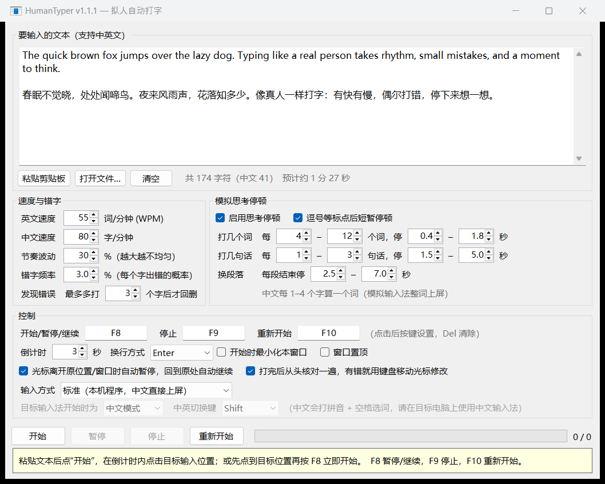

<div align="center">

# HumanTyper

**像真人一样打字的 Windows 自动输入工具**

有快有慢 · 偶尔打错再改 · 打几个词停一下 · 写完一句想一想 · 支持中英文

[](https://github.com/jiongjiong123441/HumanTyper/actions/workflows/build.yml)
[](https://github.com/jiongjiong123441/HumanTyper/releases/latest)
[](https://github.com/jiongjiong123441/HumanTyper/releases)
[](LICENSE)


[**⬇ 下载最新版**](https://github.com/jiongjiong123441/HumanTyper/releases/latest) · [使用方法](#快速上手) · [参数说明](#参数说明) · [常见问题](#常见问题) · [English](#english)



</div>

---

## 为什么做这个

普通的"自动输入"要么一次性粘贴，要么匀速逐字敲出，一眼就能看出不是人打的。
HumanTyper 把一段文字**按人的节奏**敲进任意输入框：节奏忽快忽慢、手滑打错后退格修正、写到一半停下来想想，中文还会像输入法那样一个词一个词地上屏。打完之后它还会**从头核对一遍**，有遗漏就用键盘把光标移过去改好。

## 功能

| | |
| --- | --- |
| ⌨️ **拟人节奏** | 速度随机波动，常见字母组合更快，大写和符号更慢，整体有"手感"起伏 |
| ✏️ **模拟错字** | 英文：按错相邻键、两字母打反、重复按键、漏按；中文：选错输入法候选词。可能多打几个字才发现，再退格重打 |
| 💭 **思考停顿** | 每隔几个词短停、每隔几句话长停、换段落停得更久，频率和时长都能调 |
| 🀄 **中英文混排** | 中文按 1–4 字一个词，先"拼音"再整词上屏；英文按 WPM 计速；支持 emoji |
| ⏸️ **快捷键 + 按钮** | 开始 / 暂停 / 继续 / 停止 / 重新开始，按钮和全局快捷键都能用，快捷键可自定义 |
| 🖥️ **远程桌面可用** | 键盘扫描码 / 驱动级虚拟键盘模式，发出和实体键盘一样的按键，ToDesk、向日葵、远程桌面、虚拟机里都能打字，中文自动打拼音选词 |
| 🖱️ **自动暂停 / 继续** | 切走窗口或挪动光标就自动暂停，回到原来的位置自动接着打 |
| 🔍 **打完核对** | 读回目标框里的实际文字逐字比对，用方向键 + 退格 + 重打修正，只动自己打的那一段 |
| 📦 **单文件绿色版** | 一个 ~200 KB 的 exe（内置拼音表），无需安装，Windows 10/11 自带运行环境 |

## 快速上手

1. 到 [Releases](https://github.com/jiongjiong123441/HumanTyper/releases/latest) 下载 `HumanTyper.exe`，双击运行。
2. 把要输入的文字粘贴进上方文本框（也可以"打开文件…"，支持 UTF-8 / GBK）。
3. 开始输入，二选一：
   - 点 **开始**，在倒计时（默认 3 秒）内点一下要输入的位置；
   - 或者先把光标放到目标位置，直接按 **F8**，立刻开始。
4. 坐着看它打完即可。中途想接管就按 F8 暂停，或者直接动鼠标——它会自己停下。

### 快捷键

| 操作 | 默认快捷键 | 说明 |
| --- | :---: | --- |
| 开始 / 暂停 / 继续 | `F8` | 空闲时按下：直接在当前光标处开始；运行时按下：暂停；暂停时按下：在**当前**光标位置继续 |
| 停止 | `F9` | 也可取消倒计时 |
| 重新开始 | `F10` | 停止当前任务，从头再打一遍 |

快捷键是全局的，在任何程序里都有效。在"控制"区点击快捷键框后按下新的组合键即可修改（如 `Ctrl+Shift+P`），按 `Del` 清除。

### 自动暂停与继续

勾选"光标离开原位置/窗口时自动暂停"（默认开启）后：

- **切到别的窗口** → 暂停；切回来后自动继续。
- **在目标窗口里点鼠标、按方向键等** → 暂停；把光标放回原来的位置后自动继续。
- 有些程序不公开光标位置（例如远程窗口里的对方电脑、或者本机正被 ToDesk / 向日葵远程控制时），无法判断是否回到了原处：这时把光标放回原处后**停手 3 秒会自动继续**（秒数可调，设为 0 则只能按 `F8` 继续）。
- 被远程控制时，主控端传过来的点击和按键同样算"手动操作"，会让它暂停。
- **鼠标移动也暂停**（默认开启）：鼠标指针一动就暂停——不管是本机有人动了鼠标，还是主控端通过 ToDesk / 向日葵移动了被控端的鼠标。HumanTyper 自己从不移动鼠标，所以不会误触发。
- 焦点在 ToDesk / 向日葵等远控窗口里时，这些软件会把按键截走发给对方电脑；HumanTyper 通过 Raw Input 直接从设备层读取按键，所以 `F8` / `F9` / `F10` 依然有效（按键也可能同时传到对方电脑）。

### 打完后整体核对

勾选"打完后从头核对一遍"（默认开启）后，打完会停一下"读一遍"：

1. 通过 Windows UI 自动化读取目标输入框里实际的文字，与原文逐字比对；
2. 发现漏字、多字、错字，就用 `←` `→` 把光标移过去，`Backspace` 删掉，再重新输入正确内容；
3. 改完回到末尾，再核对一遍，状态栏显示"已修正 N 处"。

只会改动本次打出的那一段，输入框里原有的内容不受影响；差异过大（比如光标被挪到了别处）时会放弃修改以免误伤。
键盘模式下，输入法选成了同音的其他汉字（如"长得"变"长的"）不会去纠结修改，只修漏字、多字和非中文内容。

### 远程桌面 / 远控软件里使用

ToDesk、向日葵、Windows 远程桌面、VNC、虚拟机这类窗口只转发**键盘按键**，不转发"直接上屏的字符"，所以要把"输入方式"改成键盘模式：

| 输入方式 | 原理 | 适用 |
| --- | --- | --- |
| 标准（默认） | 直接发送 Unicode 字符，中文直接上屏 | 本机程序 |
| 键盘扫描码 | 发送和实体键盘相同的扫描码（按下 / 抬起、Shift 组合） | ToDesk、向日葵、远程桌面、虚拟机等，无需安装任何东西 |
| 驱动级虚拟键盘 | 通过 [Interception](https://github.com/oblitum/Interception) 键盘驱动从驱动层发出按键，与实体键盘无法区分 | 少数会屏蔽软件按键的程序；需要安装驱动 |

**键盘模式下的中文**：按键只能产生字母，中文由**目标电脑上的中文输入法**打出。HumanTyper 会把中文转成拼音（内置 2.6 万字 + 多音词表，如"银行 → yinhang"），一个词一个词地敲拼音、按空格选第一个候选；遇到英文自动按 `Shift`（或 `Ctrl+Space`）切换中英文，中文标点（，。？！：“”……——）在中文模式下按对应键打出。使用前请：

1. 目标电脑切到中文输入法（微软拼音、搜狗等）；
2. 在"目标输入法开始时为"里选对它当前是**中文模式**还是**英文模式**；
3. 如果你的输入法用 `Ctrl+Space` 切换中英文，把"中英切换键"改过来。

输入法偶尔会选成同音字，属于正常现象。

**安装驱动级模式**（可选）：把"输入方式"选成"驱动级虚拟键盘"，点旁边的 **一键安装驱动**，在 Windows 弹出的授权窗口点"是"，装好后按提示重启电脑即可。

- 程序会从 [Interception 官方 Release](https://github.com/oblitum/Interception/releases/tag/v1.0.1) 下载安装包，并校验 SHA-256，校验不通过不会安装；文件放在 `%LOCALAPPDATA%\HumanTyper\Interception`。
- 不想用了：同一位置点 **卸载驱动**，授权后重启。
- Interception 仅限非商业用途免费，HumanTyper 本身不附带该驱动。

## 参数说明

| 分组 | 参数 | 默认值 | 说明 |
| --- | --- | :---: | --- |
| 速度 | 英文速度 | 55 WPM | 每分钟单词数（1 词 = 5 个字符） |
| | 中文速度 | 80 字/分 | 包含"拼音 + 选词"的时间 |
| | 节奏波动 | 30 % | 越大越不均匀，0 为匀速 |
| 错字 | 错字频率 | 3 % | 每个字出错的概率，0 为不出错 |
| | 发现错误 | 最多多打 3 个字 | 打错后可能再打几个字才回删 |
| 思考停顿 | 打几个词 | 每 4–12 个词停 0.4–1.8 秒 | 短暂停顿 |
| | 打几句话 | 每 1–3 句停 1.5–5 秒 | 想下一句 |
| | 换段落 | 停 2.5–7 秒 | 构思下一段 |
| | 标点停顿 | 开 | 逗号、分号、顿号后稍作停顿 |
| 控制 | 倒计时 | 3 秒 | 点"开始"后留给你切换窗口的时间 |
| | 换行方式 | Enter | 聊天软件里 Enter 会直接发送，可改为 `Shift+Enter` |
| | 开始时最小化 / 窗口置顶 | 关 | |
| | 输入方式 | 标准 | 远程窗口请选"键盘扫描码"或"驱动级" |
| | 目标输入法开始时为 | 中文模式 | 仅键盘模式，用于判断何时切换中英文 |
| | 中英切换键 | Shift | 仅键盘模式，也可选 `Ctrl+Space` |

所有设置自动保存在 `%APPDATA%\HumanTyper\settings.ini`。界面上还会实时显示字数和预计耗时。

## 常见问题

<details>
<summary><b>中文输入法开着会不会打乱？</b></summary>

标准模式不会：文字通过 Unicode 键盘事件直接发送，不经过输入法。键盘模式则相反，正是借助输入法打中文，请按上文"远程桌面"一节设置好输入法状态。
</details>

<details>
<summary><b>在 ToDesk / 向日葵 / 远程桌面里打不出字？</b></summary>

把"输入方式"改为"键盘扫描码"。如果打出来的中文变成了拼音字母，说明目标电脑没在用中文输入法或处于英文模式——切换后在"目标输入法开始时为"里选对状态。还不行可以试试"驱动级虚拟键盘"。
</details>

<details>
<summary><b>在某个程序里完全打不出字？</b></summary>

如果目标程序是以管理员身份运行的，Windows 会拦截普通程序发给它的按键。请右键 HumanTyper →"以管理员身份运行"。
</details>

<details>
<summary><b>代码编辑器里出现多余的缩进或括号？</b></summary>

这是编辑器的自动缩进 / 自动补全括号造成的（真人打字也会触发）。可以先在编辑器里临时关闭这些功能；开启"打完后核对"也会把多出来的字符删掉。
</details>

<details>
<summary><b>提示"目标程序不支持读取文本，已跳过核对"？</b></summary>

核对功能依赖 Windows UI 自动化读取文字。记事本、Word、Chrome / Edge 中的网页输入框等大多支持；少数自绘界面的程序（部分游戏、远程桌面窗口等）不支持，这时只会跳过核对，不影响输入。
</details>

<details>
<summary><b>暂停后迟迟不自动继续？</b></summary>

能读到光标位置时，自动继续要求光标回到**暂停前的位置**；读不到时（远程窗口等），要停止操作满设定秒数（默认 3 秒）才会继续。如果你就是想在新位置继续，直接按 `F8` 即可。
</details>

<details>
<summary><b>杀毒软件报毒？</b></summary>

程序会模拟键盘输入并监听全局按键 / 鼠标（用于检测你是否接管），部分杀软会因此误报。源码完全公开，也可以按下文自行编译。
</details>

## 从源码构建

需要 [.NET SDK](https://dotnet.microsoft.com/download)（6.0 或更新，用于编译；生成的程序运行在 Windows 自带的 .NET Framework 4.8 上）。

```bash
git clone https://github.com/jiongjiong123441/HumanTyper.git
cd HumanTyper
dotnet build HumanTyper.csproj -c Release -o out
```

生成的 `out/HumanTyper.exe` 即可直接运行。

### 项目结构

```
HumanTyper/
├─ src/
│  ├─ Program.cs         入口（单实例）
│  ├─ MainForm.cs        界面、全局快捷键、倒计时
│  ├─ TypingEngine.cs    打字引擎：节奏、错字、思考停顿、暂停/继续判断、键盘发送
│  ├─ Proofreader.cs     打完核对：读回文本、差异比对、用键盘修正
│  ├─ KeyboardOut.cs     键盘输出：Unicode / 扫描码 / Interception 驱动
│  ├─ Pinyin.cs          汉字 → 拼音（含多音词），键盘模式下打拼音用
│  ├─ Resources/pinyin.dat.gz  内置拼音表
│  ├─ CaretProbe.cs      读取前台窗口的输入焦点和光标位置（Win32 / MSAA）
│  ├─ InputMonitor.cs    低级键盘/鼠标钩子，检测用户手动操作
│  ├─ HotkeyBox.cs       快捷键录入控件
│  ├─ Settings.cs        设置的保存与读取
│  └─ NativeMethods.cs   Win32 API 声明
├─ tools/PinyinGen/      生成拼音表的小工具（数据来自 mozillazg/pinyin-data，MIT）
├─ docs/screenshot.png
├─ app.manifest
└─ HumanTyper.csproj
```

### 工作原理（简述）

- **输入**：标准模式用 `SendInput` + `KEYEVENTF_UNICODE` 逐字发送；键盘模式按标准美式键盘把字符换成扫描码（含 Shift），用 `KEYEVENTF_SCANCODE` 或 Interception 驱动发出，中文转拼音交给目标输入法。
- **节奏**：以设定速度为基准，乘以对数正态分布的随机抖动和缓慢漂移的"状态"系数，并按字符类型、常见双字母组合微调。
- **暂停检测**：记录开始时的前台窗口、焦点控件和光标坐标；每次按键后立即重新采样光标；低级钩子发现真实（非注入）的鼠标点击或按键时暂停，直到窗口、焦点和光标都回到原位。
- **核对**：开始前记下光标前已有多少文字，结束后用 UI Automation `TextPattern` 读回文本，对"本次输入的那一段"与原文做 Myers 差异比对，再从后往前逐处修正。

## 自动构建与发布

本仓库用 GitHub Actions 自动构建和发布（[`.github/workflows/build.yml`](.github/workflows/build.yml)）：

- **自动构建**：推送到任意分支、提交 PR 或手动运行时自动编译，exe 作为 Artifact 上传。
- **自动发布**：推送到 `main` 且改动了代码时，自动发布新版本 `vX.Y.N`（N 自动递增），附带 exe 和自上个版本以来的提交列表；只改文档则只构建不发布。
- 主 / 次版本号取自 `HumanTyper.csproj` 的 `<Version>`：改成 `1.1.0`，下一次发布就是 `v1.1.1`。

## 参与贡献

欢迎提 [Issue](https://github.com/jiongjiong123441/HumanTyper/issues) 反馈问题或建议，也欢迎 Pull Request：

1. Fork 本仓库并新建分支；
2. 修改后本地 `dotnet build` 确认能编译，并在记事本等程序里实际试一下；
3. 提交 PR，说明改了什么、为什么改。PR 会自动触发构建检查。

反馈问题时请尽量附上：目标程序（如 Chrome 里的某网站、Word、记事本）、复现步骤、状态栏提示文字。

## 免责声明

本工具用于演示、录屏、教学、无障碍辅助等正当用途。请勿用于违反考试、平台或任何服务规则的场景，使用者需自行承担相应责任。

## 许可证

[MIT](LICENSE) © 2026 jiongjiong123441。第三方数据的许可见 [THIRD-PARTY-NOTICES.md](THIRD-PARTY-NOTICES.md)。

---

## English

**HumanTyper** is a small Windows tool that types text into any input box the way a person would: uneven rhythm, occasional typos that get noticed and backspaced, short pauses between words and longer ones between sentences and paragraphs. It supports Chinese (IME-like word-by-word commits) and English. It pauses automatically when you switch windows or move the caret and resumes once the caret is back. After finishing, it reads the text back, diffs it against the source, and fixes any differences using arrow keys, Backspace and retyping. A keyboard mode (scan codes, or the optional Interception driver) sends real key presses so it also works inside remote-desktop / remote-control windows such as ToDesk, Sunlogin, RDP and VMs; Chinese is then typed as pinyin through the remote IME.

Download `HumanTyper.exe` from the [latest release](https://github.com/jiongjiong123441/HumanTyper/releases/latest) (Windows 10/11, no install). Default hotkeys: `F8` start / pause / resume, `F9` stop, `F10` restart. Licensed under [MIT](LICENSE).
